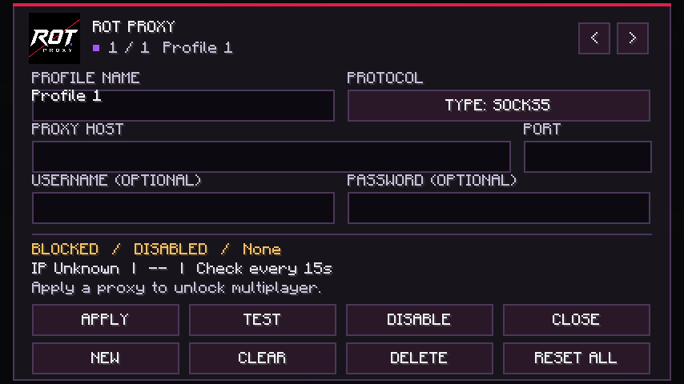
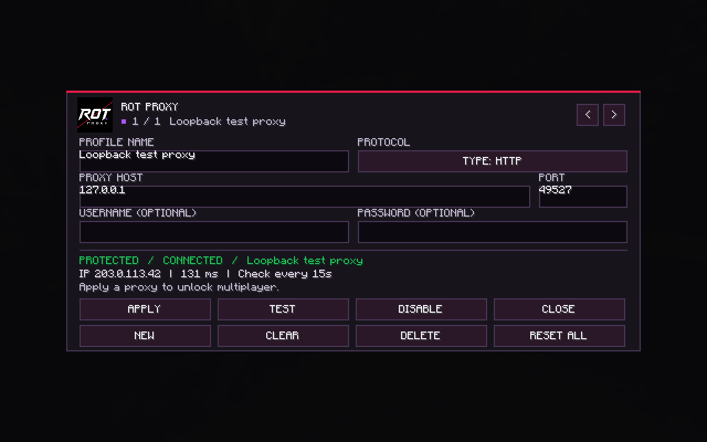

# Validation for 1.2.2+mc26.2

Validated locally on 2026-09-06 with Minecraft 26.2, Fabric Loader 0.19.5, Fabric API 0.159.0+26.2, Temurin Java 25 and an NVIDIA OpenGL renderer.

## Automated checks

- Gradle build and seven JUnit loopback integration tests passed.
- SOCKS5 without authentication and with username/password authentication.
- HTTP CONNECT without authentication and with username/password authentication.
- HTTPS CONNECT over TLS using a temporary test certificate; untrusted certificates were rejected.
- Rejected proxy authentication and invalid IP-check responses failed without a direct fallback.
- Minecraft client game test passed: required mixins applied, multiplayer shortcut opened the settings screen, NEW/DELETE/APPLY/CLOSE worked, invalid profiles stayed blocked, and draft edits survived resizing.
- 1.2.2 visual pass: text fields use padded cursor/selection layout, the settings logo is removed, and the title/profile indicator align with the form.
- UI widget bounds checked at 854 × 480 with GUI scale 2 (427 × 240 logical GUI); larger-window rendering also checked visually.
- Blocked direct joining and server-list pings while disabled. Local singleplayer serialization remained unproxied; remote serialization was rejected while blocked.
- Activated an isolated HTTP test proxy. A real Minecraft `Connection.connect` tunnel succeeded to a documentation-only destination intercepted by the fixture, confirming that the game connection took the proxy path.
- The 15-second heartbeat detected the fixture's simulated failure, closed the tracked game channel and engaged the kill switch. A later successful check restored the healthy state.

Tests use only loopback fixtures and documentation addresses. They do not need or contain a personal Minecraft account, live proxy credentials, a paid proxy subscription or a real remote Minecraft server. TLS fixture keys are generated in a temporary test directory and are not committed.

## Visual checks

The screenshots contain an isolated loopback endpoint and the documentation-only IP `203.0.113.42`, not personal proxy settings.

## Limits

No authenticated login to Hypixel or another public game server was performed. Compatibility with a particular proxy provider, real server policies, other mods and Vulkan rendering requires testing in that environment. Tests confirm the implemented network paths and UI, not complete network anonymity. See the README for traffic outside the kill switch's scope.
